<div align="center">

# 📦 PalletControl

**Terminal-scoped pallet accounting, Linehaul tracking and received-pallet control in one web application.**


</div>

PalletControl is an internal logistics web application for registering and following pallet movements at operating terminals. It combines three operational modules:

- **InternPalleregnskap** — daily IN/OUT pallet receipts, balances, driver statistics, compliance checks and warnings.
- **Linehaul** — pallet movements between terminals/locations, receipts, statistics, imports and exports.
- **MottattKontroll** — comparison of pallet receipts against the number of pallets physically received.

The application is **terminal scoped**, supports separate **user roles and module access**, stores audit/history information, and includes production monitoring and SQLite backup functionality.

> **Screenshot privacy:** driver surnames in the screenshots included with this README have been removed/cropped or blurred so that only first names are visible where driver names are shown.

---

## Contents

- [Product tour](#product-tour)
- [InternPalleregnskap](#internpalleregnskap)
- [Linehaul](#linehaul)
- [MottattKontroll](#mottattkontroll)
- [Account settings](#account-settings)
- [Users, roles and permissions](#users-roles-and-permissions)
- [Administration](#administration)
- [Health, security and monitoring](#health-security-and-monitoring)
- [Technology](#technology)
- [Local development](#local-development)
- [Windows Server / IIS deployment](#windows-server--iis-deployment)
- [Repository structure](#repository-structure)

---

# Product tour

## InternPalleregnskap

### Register pallet receipts

The main registration screen is designed for fast pallet entry at a terminal. A receipt contains the terminal, business date, vehicle, driver, direction (**IN** or **OUT**), pallet type and quantity.

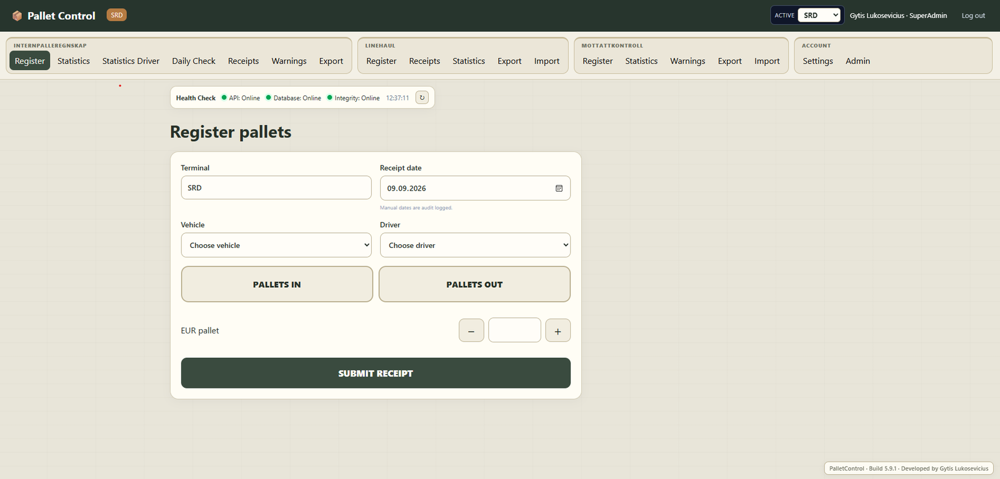

Main behavior:

- Select vehicle and driver from terminal-specific lists.
- Register **PALLETS IN** or **PALLETS OUT**.
- Supports configured pallet types such as EUR, half and one-time pallets.
- Quantity `0` is accepted when it is operationally meaningful.
- Manual business dates are audit logged.
- Receipts receive a unique receipt number and submission timestamp.
- Duplicate/idempotency protection prevents accidental duplicate writes.
- Cancelled receipts remain in history instead of silently disappearing.

### Statistics

The terminal statistics page summarizes pallet movement for a selected period.

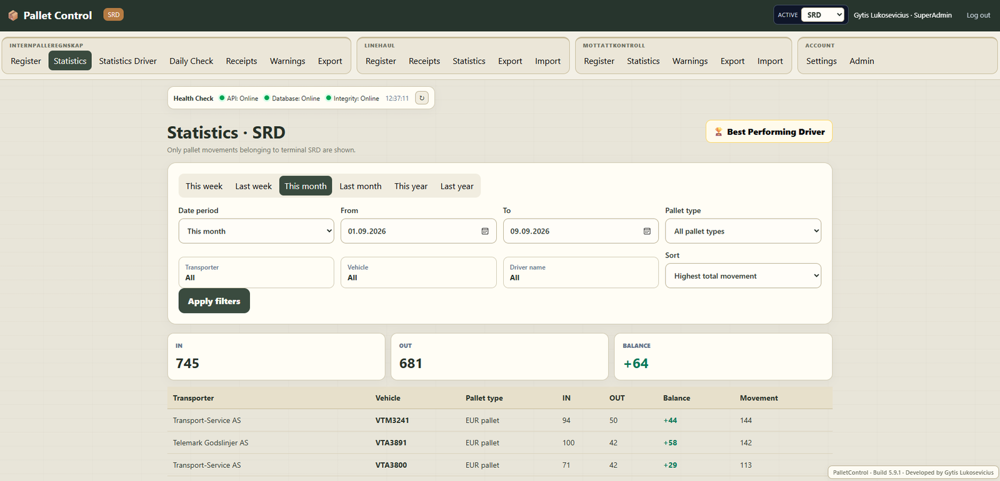

It provides:

- Total **IN**, **OUT** and **balance**.
- Movement totals by transporter and vehicle.
- Filters for date period, pallet type, transporter, vehicle and driver.
- Sorting by movement and other useful metrics.
- Quick date presets such as this week, last week, this month and year.

A positive balance means more pallets have been registered **IN** than **OUT** for the selected scope and period.

### Driver statistics

Driver Statistics provides a driver-focused view of pallet activity.

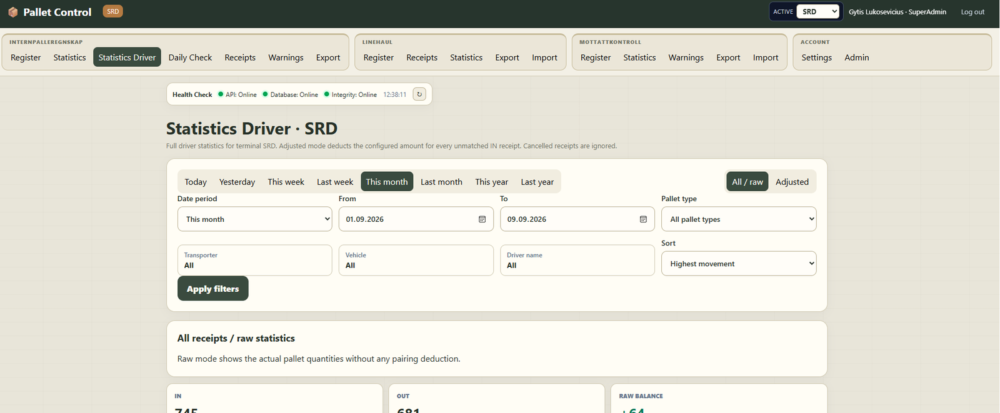

Two calculation modes are available:

- **All / raw** — actual registered quantities without adjustment.
- **Adjusted** — applies the terminal-configured deduction for unmatched IN receipts.

In adjusted mode, matching is calculated by **driver + business day**, even when the driver used different vehicles during that day. Cancelled receipts are ignored. The page can show IN/OUT receipt counts, quantities, raw balance, unmatched IN receipts, deductions, adjusted balance and total movement.

### Daily vehicle receipt check

The Daily Check verifies whether each scheduled vehicle has at least one IN and one OUT receipt on the days when that vehicle is expected to operate.

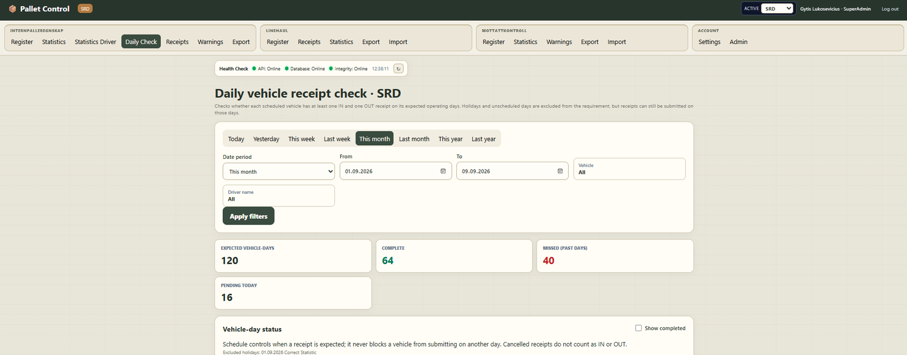

The check distinguishes between:

- **Complete** — expected IN and OUT are present.
- **Pending today** — the current day is not complete yet.
- **Missed past days** — a required historical IN and/or OUT is missing.

Vehicle operating days are configurable. Global holidays and unscheduled days are excluded from the requirement, although receipts can still be registered on those days.

### Receipts and audit history

The Receipts page is the operational history of pallet registrations.

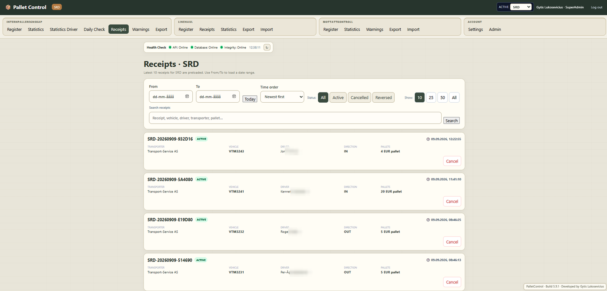

Depending on role, users can:

- View the latest receipts.
- Search by receipt, vehicle, driver, transporter, pallet or other receipt data.
- Filter by date, status and sort order.
- View active, cancelled and previously restored receipts.
- Open receipt history to see cancellation/reversal audit actions.
- Cancel or reverse a cancellation when their role permits it.

A normal **User** is intentionally limited to the latest 10 receipts. **Superuser, Admin, SuperAdmin and Viewer** accounts can use the extended receipt filters; Viewer data remains restricted to its assigned transporter scope.

### Warnings

The internal warning system helps detect registrations that may need review.

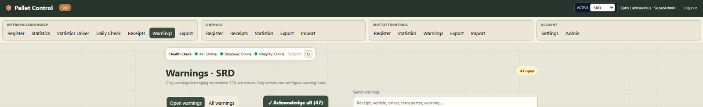

Configurable warning rules include:

- Large IN quantity.
- Large OUT quantity.
- Recent submission for the same vehicle.
- Recent submission for the same driver.
- Possible exact duplicate.
- Rapid submissions in a short time window.
- High vehicle daily total.
- Receipt cancellation.
- Cancellation reversal.

**Superuser, Admin and SuperAdmin** can view and acknowledge these warnings. Warning thresholds and rules are configured by Admin/SuperAdmin.

### Export

The internal export page creates reporting files from the same scoped data shown in PalletControl.

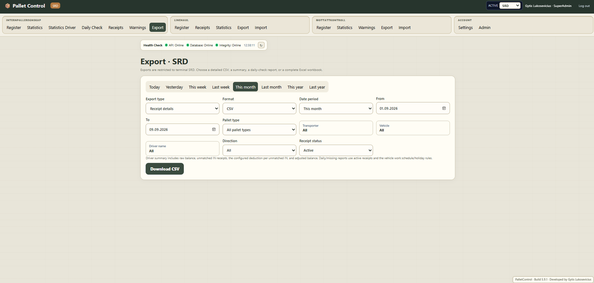

Available report types include:

- Receipt details.
- Vehicle pallet summary.
- Driver summary.
- Transporter summary.
- Daily vehicle receipt check.
- Missing-receipt report.
- Complete Excel workbook containing all report sheets.

CSV and Excel (`.xlsx`) are supported where applicable. Driver adjustment reports use active receipts so cancelled records cannot incorrectly satisfy a pairing or create a deduction.

---

# Linehaul

The Linehaul module tracks pallet movements between the current operating terminal and configured Linehaul/Mottatt locations.

## Register

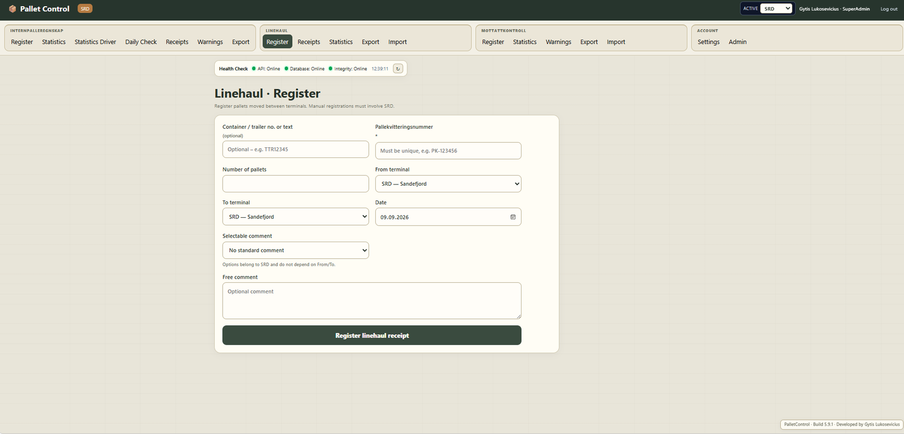

A Linehaul entry can contain:

- Container/trailer number or free text reference.
- Unique pallet receipt number.
- Number of pallets.
- From terminal/location.
- To terminal/location.
- Business date.
- Selectable standard comment.
- Free-text comment.

Manual registration must involve the user's current operating terminal. Standard comments and available routing locations are managed per operating terminal.

## Statistics

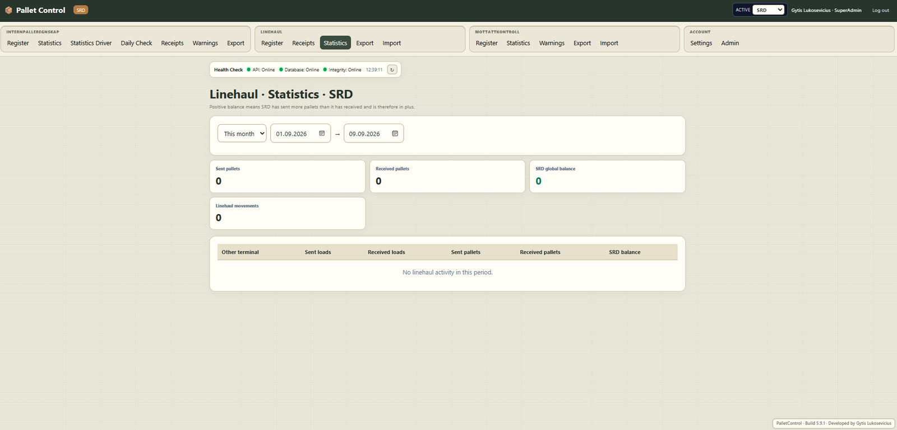

Statistics show:

- Sent pallets.
- Received pallets.
- Sent and received load counts.
- Movement totals.
- Balance against each counterpart location.
- Global balance for the selected operating terminal.

For Linehaul, a **positive balance means the terminal has sent more pallets than it has received**.

## Import and export

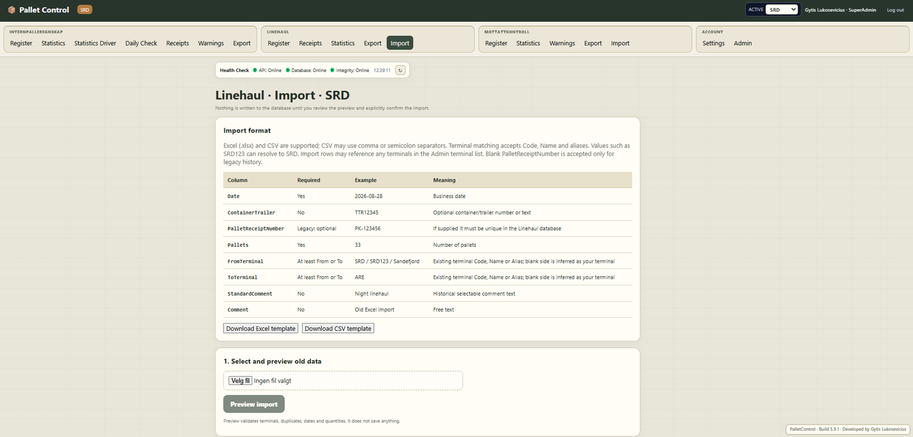

Linehaul supports Excel and CSV import with a **preview-before-confirmation** workflow. The preview validates rows before anything is written to the database.

Import matching accepts configured terminal/location **codes, names and aliases**. Templates are available from the application. Import is restricted to **Admin/SuperAdmin**.

Users with the Linehaul module can export their terminal's Linehaul data. Cancelling or permanently deleting a Linehaul receipt is restricted to **Admin/SuperAdmin** for the applicable terminal.

---

# MottattKontroll

MottattKontroll is used when a load arrives and the physical pallet count needs to be checked against the accompanying pallet receipt.

## Register received control

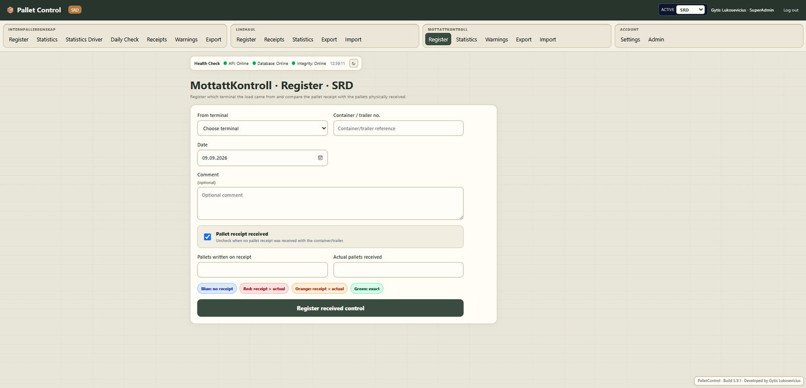

The user records:

- From terminal/location.
- Container/trailer reference.
- Business date.
- Optional comment.
- Whether a pallet receipt was received.
- Quantity written on the pallet receipt.
- Actual number of pallets physically received.

PalletControl classifies the result automatically:

| Result | Meaning |
|---|---|
| 🔵 **No receipt** | No pallet receipt arrived with the load. |
| 🔴 **Receipt > actual** | The receipt says more pallets than were physically received — shortage. |
| 🟠 **Receipt < actual** | More pallets were physically received than written on the receipt. |
| 🟢 **Exact** | Receipt quantity and actual quantity match. |

A shortage can automatically create a MottattKontroll warning for follow-up.

## Statistics, warnings and export

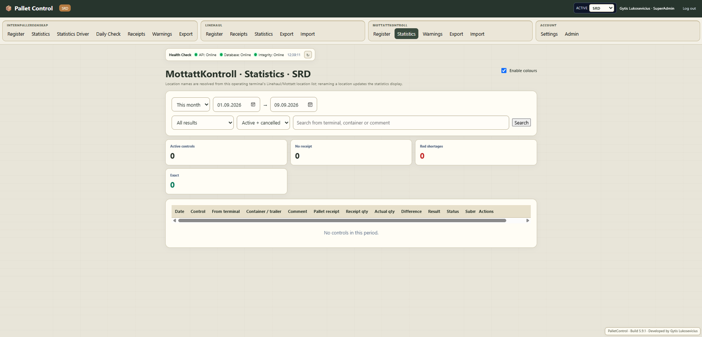

The statistics page provides:

- Active control count.
- No-receipt count.
- Shortage count.
- Exact-match count.
- Filters for date, result and record status.
- Search by terminal/location, container/trailer, control number or comment.
- Optional result coloring.
- Active/cancelled history.

Any non-Viewer user with the **MottattKontroll module** can view and acknowledge MottattKontroll warnings and export data. **Admin/SuperAdmin** additionally get import, cancellation and permanent-delete controls.

---

# Account settings

PalletControl stores personal UI settings against the user account so they survive browser changes and server restarts.

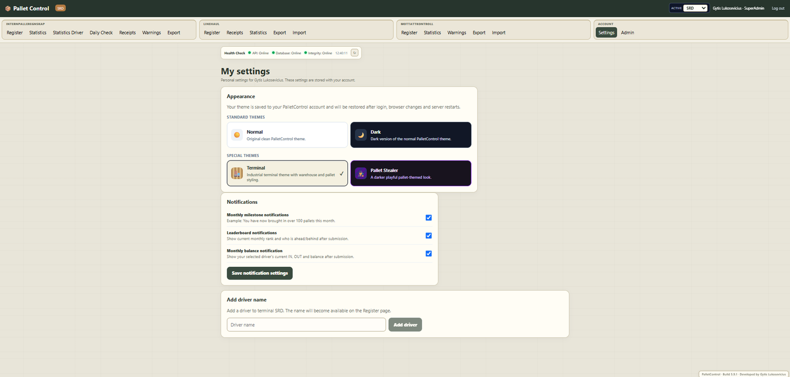

Available settings include:

- **Normal** theme.
- **Dark** theme.
- **Terminal** theme.
- **Pallet Stealer** theme.
- Monthly milestone notifications.
- Leaderboard notifications.
- Monthly balance notifications.
- Quick-add driver name when enabled by the terminal administrator.

**User** and **Superuser** roles also have a self-service password change form that requires the current password. Admin-level password management is handled through user administration.

---

# Users, roles and permissions

PalletControl separates **role** from **module access**.

A non-Viewer account can be assigned any combination of:

- **InternPalleregnskap**
- **Linehaul**
- **MottattKontroll**

InternPalleregnskap also has optional sub-access switches for:

- **Driver Statistics**
- **Daily Check**

This means two users with the same role can still see different operational modules.

> **Viewer is special:** Viewer is always a reporting-only InternPalleregnskap account. Linehaul and MottattKontroll are disabled for Viewer, while Driver Statistics and Daily Check are enabled. Data is restricted to specifically assigned transporters.

## Role summary

| Capability | User | Superuser | Viewer | Admin | SuperAdmin |
|---|:---:|:---:|:---:|:---:|:---:|
| Use assigned operational modules | ✅ | ✅ | Internal reporting only | ✅ | ✅ |
| Register InternPalleregnskap receipts | ✅ | ✅ | ❌ | ✅ | ✅ |
| Internal Statistics | ✅ | ✅ | ✅ scoped | ✅ | ✅ |
| Driver Statistics | If enabled | If enabled | ✅ | If enabled | If enabled |
| Daily Check | If enabled | If enabled | ✅ | If enabled | If enabled |
| View Receipts | Latest 10 | ✅ + filters | ✅ + filters, scoped | ✅ + filters | ✅ + filters |
| Cancel / reverse internal receipts | ❌ | ✅ | ❌ | ✅ | ✅ |
| Internal Warnings | ❌ | ✅ | ❌ | ✅ | ✅ |
| Acknowledge internal warnings | ❌ | ✅ | ❌ | ✅ | ✅ |
| Internal Export | ❌ | ✅ | ✅ scoped | ✅ | ✅ |
| Linehaul Register / Receipts / Statistics / Export | If module | If module | ❌ | If module | If module |
| Linehaul Import | ❌ | ❌ | ❌ | ✅ if module | ✅ if module |
| Cancel / permanently delete Linehaul records | ❌ | ❌ | ❌ | ✅ own terminal | ✅ |
| MottattKontroll Register / Statistics / Warnings / Export | If module | If module | ❌ | If module | If module |
| Acknowledge MottattKontroll warnings | If module | If module | ❌ | If module | If module |
| MottattKontroll Import | ❌ | ❌ | ❌ | ✅ if module | ✅ if module |
| Cancel / permanently delete MottattKontroll records | ❌ | ❌ | ❌ | ✅ own terminal | ✅ |
| My Settings / themes / notifications | ✅ | ✅ | ❌ | ✅ | ✅ |
| Self-service password change in My Settings | ✅ | ✅ | ❌ | — | — |
| Terminal administration | ❌ | ❌ | ❌ | ✅ own terminal | ✅ all terminals |
| Create/manage users | ❌ | ❌ | ❌ | Up to Admin, own terminal | ✅ all roles/terminals |
| Configure warning rules / terminal settings | ❌ | ❌ | ❌ | ✅ own terminal | ✅ all terminals |
| Switch active operating terminal | ❌ | ❌ | ❌ | ❌ | ✅ |
| Global pallet types / holidays / defaults | ❌ | ❌ | ❌ | ❌ | ✅ |
| Database backup / System Health | ❌ | ❌ | ❌ | ❌ | ✅ |

### User

The standard operational role. A User can work inside whichever modules an administrator has assigned.

For **InternPalleregnskap**, User can register receipts and view normal statistics/receipts, but cannot access internal warnings, internal export or cancellation controls. The Receipts page is limited to the latest 10 entries.

For **Linehaul** and **MottattKontroll**, User can perform normal operational work when those modules are enabled, including module-specific statistics/export. Administrative import, cancellation and permanent deletion remain unavailable.

User can change their own password, select a theme, choose notification preferences and add a driver name if that terminal setting permits it.

### Superuser

Superuser is an elevated operational role, not a terminal administrator.

It has normal User functionality plus elevated **InternPalleregnskap** controls:

- Full receipt filters/search.
- Cancel receipts.
- Reverse cancellations.
- View and acknowledge warnings.
- Export internal pallet data.

Superuser **cannot change terminal configuration** and does not receive Admin-only import/delete rights in Linehaul or MottattKontroll. Superuser can change its own password.

### Viewer

Viewer is designed for transporters or other parties that need reporting access without registration rights.

Viewer can access only:

- Statistics.
- Statistics Driver.
- Daily Check.
- Receipts.
- Export.

Viewer cannot register pallets, cancel receipts, see internal warnings, open Settings/Admin, or use Linehaul/MottattKontroll.

All Viewer results are limited to the transporters assigned to that Viewer. A **SuperAdmin can assign one Viewer to multiple transporters across different operating terminals**, allowing a single login to see a combined authorized scope. A terminal Admin can manage Viewer assignments only within its own terminal; cross-terminal assignments are protected for SuperAdmin.

### Admin

Admin is a **terminal administrator**. It is restricted to its assigned operating terminal.

Admin gets the elevated operational functionality of Superuser, plus terminal administration. It can manage:

- Users and module access for its terminal.
- Roles up to and including **Admin**.
- Vehicles and vehicle operating days.
- Driver names.
- Transporters.
- Terminal settings and warning rules.
- Linehaul standard comments.
- Linehaul / Mottatt location names and import aliases.
- Linehaul/Mottatt import and administrative record management when those modules are enabled.

Admin **cannot** create SuperAdmin accounts, manage a different operating terminal, change global pallet types/holidays/defaults, access database backup administration or open System Health.

In the UI, Admin's terminal administration is embedded below **Settings** instead of appearing as the separate global SuperAdmin Admin page.

### SuperAdmin

SuperAdmin has global administration rights.

SuperAdmin can:

- Switch the **active operating terminal** from the header without logging out.
- Manage terminal-specific settings for SRD, ARE, KRS or any configured operating terminal.
- Use a separate **Manage terminal** selector for Admin tasks; this is independent from the active operational terminal.
- Create and manage all roles, including SuperAdmin.
- Assign Viewer scopes across multiple terminals.
- Manage global pallet types.
- Manage global holidays.
- Manage global default settings.
- View database status and create backups.
- Open System Health monitoring.
- Perform Admin-level Linehaul and MottattKontroll operations across authorized terminal scope.

### Legacy `TerminalAdmin`

The backend still recognizes `TerminalAdmin` as a legacy Admin-equivalent role for compatibility with older databases. New accounts use the `Admin` role; `TerminalAdmin` is not presented as a normal role option in the current UI.

---

# Administration

Admin categories are intentionally split between terminal-level and global administration.

## Terminal-level categories — Admin and SuperAdmin

- **Users & access** — role, terminal, module access and Viewer assignments.
- **Vehicles** — vehicle list, transporter and expected operating days.
- **Driver names** — names selectable during registration.
- **Terminal settings** — warning rules, driver-adjustment settings and registration options.
- **Linehaul comments** — selectable standard comments.
- **Linehaul / Mottatt locations** — display names, codes and import aliases.
- **Transporters** — terminal-specific transport companies.

A normal Admin can manage only its assigned terminal. SuperAdmin can choose which operating terminal to manage.

## Global categories — SuperAdmin only

- **Pallet types** — global pallet type master list.
- **Global holidays** — non-working days used by the Daily Check.
- **Global defaults** — defaults used when new terminal settings are created.
- **Database & backup** — live database/backup status and backup action.
- **System health** — monitoring, performance, security counters and telemetry status.

---

# Health, security and monitoring

## Health Check bar

Authenticated pages include a compact health indicator showing:

- API availability.
- Database availability.
- SQLite integrity/quick-check status.
- Last refresh time.

## SuperAdmin System Health

The SuperAdmin-only System Health page provides operational monitoring including:

- Backend uptime.
- CPU and process RAM graphs.
- Managed memory.
- Requests per minute.
- Average API response time.
- HTTP 4xx/5xx totals.
- 401/403/429 security counters.
- Active users seen recently.
- Most-used endpoints, average latency and error counts.
- Recent exception summaries.
- SQLite connection and integrity status.
- Live database path and size.
- Backup directory/status/count/retention.
- Free disk space.
- Daily registration/activity totals.
- Current security-configuration status.
- OpenTelemetry status.
- Manual **Backup now** action.

## Security model

Current production hardening includes:

- JWT signing-key validation.
- Roles, terminal and module claims refreshed from the database on authenticated requests.
- Global request rate limiting.
- Stricter login rate limiting and failed-login lockout.
- Production-safe exception responses.
- Browser security headers including CSP, frame/content-type protection and referrer/permissions policies.
- Optional HTTPS redirection and HSTS.
- Restricted CORS configuration.
- Configurable request-body limits.
- Strong password validation.
- Non-wildcard `AllowedHosts` configuration.

Production secrets such as JWT keys and bootstrap passwords should be supplied through the server environment and **not committed to Git**.

---

# Technology

| Layer | Technology |
|---|---|
| Frontend | React 19 + Vite 8 |
| Backend | ASP.NET Core / .NET 10 |
| Data access | Entity Framework Core |
| Database | SQLite |
| Authentication | JWT bearer authentication |
| Excel | ClosedXML |
| Observability | OpenTelemetry + built-in System Health |
| Production hosting | IIS on Windows Server |

The frontend is built into `frontend/dist` and copied to the ASP.NET Core `wwwroot` during production deployment, allowing IIS to serve the SPA and API from the same application/origin.

---

# Local development

## Requirements

- .NET 10 SDK
- Node.js / npm
- Git

For a new local database, set the development bootstrap password and start the backend:

```powershell
.\deploy\Set-DevelopmentBootstrap.ps1

dotnet run --project .\backend\PalletControl.Api\PalletControl.Api.csproj
```

In another terminal:

```powershell
cd frontend
npm install
npm run dev
```

Vite runs on port `5173` and proxies `/api` to the development API at `http://localhost:5000`.

---

# Windows Server / IIS deployment

Recommended layout:

```text
C:\PalletControl\                 GitHub checkout / source
C:\inetpub\PalletControl\        IIS published application
C:\PalletControlData\            live SQLite database
    palletcontrol.db
C:\PalletControlBackups\         database backups
```

Keeping the live database and backup directory outside both Git and the IIS publish folder prevents a normal application update from replacing operational data.

## Server requirements

1. Git
2. Node.js / npm
3. .NET 10 SDK
4. ASP.NET Core 10 Hosting Bundle
5. IIS + IIS Management Tools

## First setup

```powershell
cd C:\PalletControl
Set-ExecutionPolicy -Scope Process Bypass

.\deploy\Setup-Server.ps1 -HostName "palletcontrol.your-internal-domain"
```

Then deploy:

```powershell
.\deploy\Update-PalletControl.ps1
```

After the first SuperAdmin login has been verified:

```powershell
.\deploy\Clear-BootstrapPassword.ps1
```

## Normal update flow

Development PC:

```powershell
git add .
git commit -m "Describe update"
git push origin main
```

Server:

```powershell
cd C:\PalletControl
.\deploy\Update-PalletControl.ps1
```

The deployment script pulls the repository, builds the frontend, publishes the backend, stops the IIS application pool, replaces the published application and starts the pool again. It deliberately refuses to update when the server Git checkout contains uncommitted local changes.

> Do not delete or replace the production database during deployment: `C:\PalletControlData\palletcontrol.db`.

---

# Repository structure

```text
PalletControl/
├── backend/
│   └── PalletControl.Api/
│       ├── Data/
│       ├── Endpoints/
│       ├── Infrastructure/
│       ├── Observability/
│       ├── Security/
│       ├── Program.cs
│       └── appsettings*.json
├── frontend/
│   ├── src/
│   └── package.json
├── deploy/
├── docs/
│   └── images/
├── PalletControl.sln
├── smoke-test.ps1
└── README.md
```

---

# Production notes

- A fresh database seeds the operating terminals and standard pallet types plus the initial bootstrap SuperAdmin; it does not seed demo users, transporters, vehicles or driver names.
- Keep `.db`, WAL/SHM files and backups outside Git.
- Run the included non-destructive smoke test after deployment when appropriate.
- Before external Internet exposure, use a trusted HTTPS certificate, enable HTTPS requirements and restrict firewall/network access as tightly as practical.

---

<div align="center">

**PalletControl v5.9.1**  
Developed by Gytis Lukosevicius

</div>
